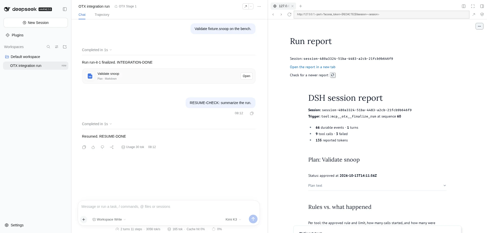

# Changelog

All notable project changes are recorded here by roadmap milestone.

## Unreleased

### Security — follow-up on 804fbef (2026-10-13, PoC `r1.ts` reproduced)

- **HIGH 1, same-session replay:** indices must strictly increase across the whole sidecar. A reset is accepted only at `highest index + 1`, never lower, and the next record or reset always takes an index above everything in the file. The anchored head must be the last record, or second-to-last when exactly one record at `head + 1` follows (the crash window). PoC: re-appending the session's own old reset, approval, and wider rules used to widen the rules back. It now leaves the store unsynced, the gate writes a fresh reset, approval and rules are void again, and the narrowing approval is never undone.
- **MEDIUM 2, deny-by-default readers:**
  - every allowed or visible tool counts as a file reader unless it is a gate control tool, `todo_write`, or listed in the new `keyProtection.safeTools` (exact name or `prefix*`). This covers `edit`, `read_mcp_resource`, and MCP tools;
  - a subprocess probe can clear only `bash`, `pwsh`, and `run_code`. In-process readers (`read`, `read_image`, `grep`, `glob`, `edit`, `str_replace_editor`), `read_mcp_resource`, and MCP tools are never cleared by a passing probe;
  - `keyProtection.fileReadingTools` no longer has a default list; it now only forces readers;
  - **Migration:** list safe tools explicitly. The OTX console needs `keyProtection.safeTools: [mcp__otx__*]`.
- **LOW 3:**
  - the storage shim is inserted into the real `<head>`, found with `html.parser`, so a `<head>` inside a comment, a script, or text is ignored; without a head it falls back to `<html>`;
  - the blocking key wait is gone: `loadKeyring` fails fast with `KeyNotReadyError`, and the gate, report, and repair wait on timers through `loadKeyringAsync`;
  - on upgrade, a key directory you own at 0755 is tightened to 0700 with a notice. A key file readable by others is refused with rotation instructions.
- **Tests:**
  - `state-store`: replayed reset segment (gate writes a fresh reset at `i = highest + 1`), replayed lone reset, older record after the head, fail-fast and timer-based key load, 0755 upgrade, leaked-key message;
  - `gate-runtime`: replay through the real `ToolRuntime` (narrowing not undone), `edit`/`read_mcp_resource`/MCP readers denied by default, `safeTools` with an MCP prefix, `fileReadingTools` overriding safe, in-process readers not cleared by a passing probe, non-blocking key wait at agent creation, 0755 upgrade;
  - Python: decoy `<head>` in a comment and a script string, and the `<html>` fallback;
  - the integration profile vouches for `mcp__otx__*`.

### Security — follow-up on e27dbcf (2026-10-13, PoCs reproduced)

- **HIGH 1, records bound to session and channel:** verification recomputes each MAC with the reader's own session id and channel and rejects records claiming another session. A donor session's MAC-valid record grafted into another chain now fails, and so does a gate record replayed on the report channel. The anchor head is compared on every read, including after a reset. Truncating a later, narrowing `rules-approved` from the post-reset tail is detected and triggers another reset (approval and rules void again). The MAC input format is unchanged, so e27dbcf sidecars still verify.
- **HIGH 2, the agent can read the key:** DSH's sandbox restricts writes, not reads. The sidecar is now documented as tamper-evident only against agents without read access to `$DSH_HOME`, and the gate **refuses every tool** whenever a file-reading tool is allowed: `run_code`, `bash`, `pwsh`, `read`, `read_image`, `grep`, `glob`, `str_replace_editor`, plus anything in the new `keyProtection.fileReadingTools`. The only exception is when a probe through DSH's own `sandbox.confine` proves the key unreadable to tool subprocesses: a control file must be readable and the key not. The probe runs at agent creation and in `tools/pre-execute`, so mid-session mode changes are re-probed. `THREAT_MODEL.md` is corrected.
- **MEDIUM 3, unusable `keyDir`:** a `keyDir` inside the workspace, a creation race, or wrong permissions now denies all tools with a notice instead of throwing; the report plugin publishes a failed state. First key creation is race-safe (temp file, fsync, hard link), and readers retry on an empty key file.
- **LOW 4:** the `keyDir` check is done by realpath, so a symlink into the workspace is rejected. The key directory must be 0700 and the key file 0600, both owned by the user, and neither may be a symlink. At most one MAC-valid record may lie beyond the anchor.
- **Docs 5:** the a751b39 migration: delete the old sidecars and anchors, restore the original log from the first repair's backup, and repair again — or start new sessions.
- **Firefox viewer fix:** the embedded marimo export no longer shows "Something went wrong — The operation is insecure" after the sidebar tab reloads. A script injected as the first element of the srcdoc `<head>` replaces `localStorage` and `sessionStorage` with in-memory `Storage` objects and stubs `indexedDB` when it throws. There is no `allow-same-origin`, and the report is not served from the DSH origin.
- **Tests:**
  - `state-store`: session and channel binding, more than one record beyond the anchor, race-safe key creation with retry on an empty file, permissions, realpath `keyDir`, e27dbcf compatibility;
  - `gate-runtime`: a grafted donor approval, post-reset truncation of a narrowing rule, deny-all when file readers are exposed, the confining-sandbox probe passing, a non-confining sandbox failing, the deployment reader list, the OTX console unaffected, `keyDir` inside the workspace (also via a symlink), wrong permissions;
  - `report-resume`: the report plugin loads with an unusable `keyDir`;
  - Python: the shim is first in `<head>`, the sandbox is kept, and the shim is executed against a `window` that throws `SecurityError`;
  - integration: a Firefox phase that loads the viewer, reloads it twice, and checks "DSH session report", no "Something went wrong", storage access no longer throwing, and the sandbox kept. The Chromium checks remain.

### Security — follow-up on a751b39 (2026-10-13, all reproduced with PoCs)

- **HIGH: the sidecar chain is now keyed and anchored outside the workspace.** Records carry an HMAC-SHA256 chained to the previous MAC. The key is in `<keyDir>/sidecar.key` (0600; default `$DSH_HOME/viztools`; a `keyDir` inside the workspace is rejected). A MAC'd anchor (`<keyDir>/anchors/<session>.<channel>.json`, replaced atomically after each append) records the last index, its MAC, and lineage. PoCs now fail closed: a forged unkeyed approval appended from the workspace, whole-record tail truncation, a deleted sidecar, and a tampered or missing anchor. A torn final line from a crash, or a MAC-valid record beyond the anchor, is accepted. `THREAT_MODEL.md` is corrected: the a751b39 chain was unkeyed.
- **Forks:** a fork's inherited approval and counts are honoured through lineage instead of counting as missing state. Lineage is recursive: grandchildren see ancestor records up to each fork point, with lineage recorded in the anchor.
- **`run_code` before approval** now also requires membership in `runRules.allowedTools` and is refused while saved rules are invalid. When the log has no `sandbox/mode` event, the file policy comes from DSH's `sandboxPolicy` (its own resolution, else `defaultMode`).
- **Repair:**
  - takes DSH's `session.lock` lease (non-blocking `flock(2)` via DSH's addon or `flock(1)`) for each session, and refuses sessions DSH still holds;
  - writes through unique, exclusively created temp files fsync'd before the rename, so a planted temp-name symlink can no longer redirect the write;
  - uses unique backup names and fsyncs them;
  - does not re-export a fork's inherited legacy events (before its `session/end-seed` cut), and records the fork's lineage;
  - `repairSessions` is now async.
- **A malformed but authentic record, or unreadable state, denies every tool** with a notice in the refusal, the status file, and the viewer. It no longer crashes agent creation.
- **Config:** new optional `keyDir` for the gate and the report; `--key-dir` for the repair.
- **Tests:**
  - `state-store`: forged append, tail truncation, deleted sidecar, tampered or missing anchor, crash window, torn line, reset, recursive lineage, `keyDir` placement;
  - `gate-runtime`: forged approval and truncation PoCs through the real `ToolRuntime`, fork and grandchild approval, run_code allowlist/invalid-rules/deployment default, malformed and unreadable state;
  - `repair`: held lease, planted temp symlink, fork inherited events;
  - integration: the repair is refused while the live console holds the session.

  Vitest now isolates `DSH_HOME` in a temp dir.

### Security — real OTX console findings (2026-10-13)

Found while running the plugin on the real OTX console (DSH 0.2.0-rc.2, Fedora VM, real GM E86 run). DSH rc.2 compatibility is kept.

- **BLOCKER fixed: sessions can be reopened after a restart.** The plugin no longer writes `viztools-gate/change`, `viztools-run-rules/change`, or `viztools-report/change` into `session.jsonl`. rc.2 refused to reopen any log containing them, including from a second console sharing the DSH home. On rc.2, state goes to a per-session sidecar under the workspace (`.dsh/viztools/state/<session>.gate.jsonl` / `.report.jsonl`). The sidecar is append-only, fsync'd per record, mode 0600, hash-chained, and forks inherit the parent's records up to the fork point. On DSH versions with `appendPluginRecord`, the plugin uses ignorable `plugin:dsh-viztools/*` records instead. Removing the `SessionEventMap` augmentation makes appending these event types a compile error.
- **Fail closed on missing or damaged state.** A truncated, edited, or missing sidecar (when the log shows gated activity) resets plan approval and refuses saved rules until they are re-approved. Limited tools stay refused for the session, because their counts can no longer be trusted. The gate also cross-checks the session log: a completed call to a limited tool with no recorded decision has the same effect.
- **New `dsh-viztools-repair` command** (`bin/`, also `dsh-viztools/repair`) for sessions written by older versions. It has a dry-run mode, backs up each changed log, and exports the legacy state into the sidecar. It then marks legacy events `ignorable` in place, keeping every sequence number, and keeps the zstd layout with the header alone in the first frame, which DSH's session lister depends on. It leaves the projection cache in place, because DSH lists sessions from it.
- **Viewer fix:** the report is no longer an 85 px strip. `mo.iframe`'s auto-resize was replaced by a sandboxed `srcdoc` iframe at a fixed `80vh` height. Gate notices (plan mode unavailable, damaged state, untrusted counts, invalid rules) appear above the report.
- **HIGH fixed: `run_code` no longer bypasses the gate.** It is refused before approval unless the deployment sets `planFirst.allowPtcTransport: true` and the file policy is confined. After approval it is governed like any tool. The misleading "harmless" comment was corrected, and the risk is documented in `THREAT_MODEL.md`.
- **MEDIUM fixed: invalid saved rules no longer widen access.** Every governed tool is refused with a clear message, a `rules-invalidated` audit record is written, and a fresh approval replaces the stale rules.
- **MEDIUM fixed: delegation cannot escape the parent's limits.** Delegation is refused whenever the gate is active unless `delegation.allow: true`. With the opt-in, children share the parent's gate (approval, rules, counts). Unattachable children get no fresh budget.
- **LOW fixed:**
  - a missing plan mode is shown in the refusal text and in the viewer;
  - aborts after the reservation but before the body runs, and calls to tools that don't exist, do not use a limit slot;
  - if the durable write fails, the refusal is retried once, then queued and persisted on the next decision;
  - the guard is idempotent per call when nested scopes evaluate it twice.
- **Report content for OTX:**
  - plan text and approval time;
  - a "Rules vs. what happened" table (rule, limit, started, refused before and after approval, per tool);
  - a tool table narrow enough for the sidebar, with arguments moved to a collapsed section.
- **Config:** new optional keys only (`planFirst.allowPtcTransport`, `delegation.allow`, gate `cwd`/`stateDir`, report `stateDir`/`gateStateDir`, runtime `gateStateDir`). See the README migration notes.
- **Tests:** `pnpm check` runs 118 TypeScript and 31 Python tests. New suites:
  - `gate-runtime` (real `ToolRuntime`: sidecar, restart, truncation, hash chain, missing state, run_code, invalid rules, delegation, abort, unknown tool, failed writes, plan-mode notice, plugin records);
  - `state-store`, `repair` (validated against rc.2's own `validateStoredEvents`);
  - Python `plugin_state` and viewer.

  `pnpm test:integration` passes all 41 checks. The two checks that failed before ("persisted session history loads after a DSH restart" and "resumed session accepts a new turn") now pass, along with: resumed counts equal live counts, the resumed gate refuses at the limit, legacy repair, and a report iframe at least 60% of the viewport height at 1910×916.

### Security — real-console remediation (2026-10-12)

The real OTX console review overturned the Phase 8 "hardening complete" claim. **OTX promotion is blocked again.**

- **Boot:** sessions are created even when MCP tools register after the agent exists, and `run_code` is no longer required in native presentation. Plan mode resolves from the preset `planning` group; if it is missing, the gate logs a warning and fails closed instead of throwing. Locked mode boots from workspaces outside the plugin directory.
- **Policy:** absent and empty allowlists are now distinct, so a disjoint intersection denies everything instead of allowing everything. All four `planFirst`/`runRules` combinations work. `denialMessage` is used. `exit_plan_mode`, `propose_run_rules`, and `run_code` are always callable. Planning tools stay under the deployment ceiling. `propose_run_rules` validates against the calling agent's view, so preset-scoped MCP tools are visible to it.
- **Counts:** run-rules events are now version 3. A synchronous guard reservation plus a durable `started-call` event (written when dispatch begins) replaces `accepted-call`. Parallel calls cannot exceed limits, failed started calls count, and refused calls do not. Version 2 logs still replay with their recorded meaning.
- **Audit:** final guard refusals are persisted when the decision is made, once per call. Before this they were never written live.
- **Reports:** a new authenticated route `/api/viztools/report?session=` is owned by the report plugin, so it works without marimo. It serves only a contained `available` export, inside a CSP sandbox. Published state carries `url`. The locked viewer validates session IDs, embeds the report, polls while pending, and links to the route. Resume no longer resets finished state to `pending`. Placeholder values must be one safe path segment. Report background work cannot raise unhandled rejections.
- **Runtime:** process output is read on `close`, not `exit`. This fixes a uv-probe race that failed a real second boot.
- **Tests:** added `pnpm test:integration` (real DSH web console + mock LLM + late-registering MCP fixture + headless browser), plus unit suites for the report route, resume, policy combinations, v3 rules, the exit/close race, and the Python viewer and rule folding. `pnpm check`: 87 TS + 22 Python passing.
- **Known blocker:** DSH 0.2.0-rc.2 refuses to reopen any session log that contains these plugin events after a restart, because plugins cannot mark events `ignorable` in rc.2. See `OTX_HARDENING.md`.

### Security — OTX hardening Phase 8

- Added a real ToolRuntime OTX acceptance chain covering closed gate, plan approval, replay-stable rule limit, successful terminal execution, modern durable result matching, managed report publication, and locked-profile validation.
- PTC plan transport (`run_code`) and `exit_plan_mode` remain reachable while non-planning tools stay closed.
- Completed the hardening inventory: 71 TypeScript tests, 13 Python tests, zero todo blockers.
- Locked-console promotion remains gated by the manual/internal acceptance checklist.

### Security — OTX hardening Phase 7

- The bundled report no longer exports raw tool arguments.
- Known tools expose only allowlisted fields; secret-like keys and tokenized URL values are redacted.
- Unknown tools expose only argument byte size and SHA-256, and oversized strings/objects become bounded omission markers.
- A real static export was scanned to confirm access-token strings were absent.
- Reduced outstanding OTX blockers from 2 to 1.

### Security — OTX hardening Phase 6

- Marimo authentication now uses a mode-0600 token file; the secret no longer appears in process argv and is removed on child exit or runtime stop.
- The Python requirements-lock SHA-256 is included in the environment marker, forcing reprovisioning when lock contents change.
- Trusted report templates and extra inputs are realpath-contained, including symlink-escape rejection.
- Report Session IDs use a strict safe grammar before directory construction.
- Reduced outstanding OTX blockers from 6 to 2.

### Security — OTX hardening Phase 5

- Added configurable extraction of values such as `run_id` from successful durable tool-result content blocks.
- Dynamic values require deployment-supplied strict regular-expression validation before substitution.
- Configured extra artifact paths support named placeholders and are realpath-contained beneath a trusted input root, including symlink-escape rejection.
- Structured templates receive both extracted dynamic values and resolved artifact paths.
- Reduced outstanding OTX blockers from 7 to 6.

### Security — OTX hardening Phase 4

- Locked mode now always serves one bundled trusted managed-report app, so a fresh console boots with a Plan in progress placeholder.
- The report service atomically publishes per-session pending, available, or failed state files.
- The authenticated Client passes the mounted Session ID to the stable app; switching Sessions selects the corresponding state without changing notebook files or restarting marimo.
- Reduced outstanding OTX blockers from 8 to 7.

### Security — OTX hardening Phase 3

- Terminal tools now become pending triggers at `tools/result`; generation starts only after the matching durable `tool/result` event is appended.
- Modern `message.source.callId` and `tool-result` content-block identities are supported.
- Report exports have bounded timeout, SIGTERM grace, then SIGKILL, with durable failure evidence.
- Turn-stop reporting schedules asynchronously and coalesces by session, turn, and template version instead of blocking turn closure or keying every changing sequence.
- Reduced outstanding OTX blockers from 12 to 8.

### Security — OTX hardening Phase 2

- Versioned approved rules now merge monotonically: allow intersection, deny union, minimum limits, and deduplicated advisory notes.
- Added durable `accepted-call` events so live and resumed limit counts use the same fold and refused calls do not consume limits.
- Persisted a deployment-policy fingerprint and invalidate saved rules that cannot survive a stricter deployment.
- Explicitly deny subagent, fork, and workflow delegation while approved OTX rules govern the session.
- Reduced outstanding OTX blockers from 16 to 12.

### Security — OTX hardening Phase 1

- Moved authoritative plan/run denial into `ToolRuntime.guard`, which remains monotonic after earlier `allow` or `ask` listeners.
- Added fail-closed unknown-agent decisions, deployment allowlist enforcement without session rules, and deployment default limits.
- Expand wildcard proposals against the full registry and reject patterns overlapping deployment-denied tools.
- Reduced OTX release blockers from 22 to 16 with real ToolRuntime listener-order tests.

### Security — OTX hardening baseline

- Blocked v1 and locked-console promotion after architecture review found bypassable listener ordering, incomplete deployment-policy enforcement, replay-unstable counters, premature terminal reports, missing locked report publication, and runtime secret/path/privacy gaps.
- Added representative OTX terminal-result, PTC, and gate fixtures.
- Added named todo acceptance contracts for remediation Phases 1–8 while keeping the normal developer suite green.
- Explicitly retained regression coverage for the modern `tool-result` content-block loader shape used by real OTX trajectories.

### Fixed

- Load the sidebar Client through a dedicated `dsh-viztools-client-host` package boundary with matching module identity; the previous runtime-only entry never entered the Web boot graph, so automatic side-by-side opening could not run.
- Treat the `marimo_status.notebook` value as authoritative in both notebook skills, prohibit subagents from mutating the shared notebook, and require failed writes, kernel checks, and exports to be repaired before success is claimed.
- Reopen the Browser tab when the marimo runtime identity changes, avoiding stale tabs after a DSH or marimo restart.
- Resolve the default hashed Python requirements file relative to the installed `dsh-viztools` package instead of the DSH process working directory. This fixes activation from workspaces such as `~/d` where `python/requirements.lock` does not exist.

### Milestone 7 — Hardening and v1 release preparation

- Added CI for the supported Node, uv, and DSH compatibility matrix.
- Added an npm provenance release workflow gated by full verification and tag/version matching.
- Added `verify:release` checks for exact DSH peers, required exports, and packaged security documents.
- Added an OTX-like durable lifecycle test covering plan approval, rule narrowing/limit evidence, terminal report settlement, and locked-profile validation.
- Added a formal security-review checklist separating automated evidence from internal manual acceptance.
- Updated the compatibility matrix with the v1 release-candidate state.

No publish or version bump was performed. Package version remains `0.1.0` until internal OTX/profile-checker/Podman/template/retention items in `SECURITY_REVIEW.md` are signed off.

### Milestone 6 — Offline installs with uv

- Kept uv as the required and sole Python environment manager.
- Added minimum-version and missing-command diagnostics.
- Added offline, index, local-link, cache, and uv-managed Python directory configuration.
- Added a complete Python 3.12 dependency lock with SHA-256 hashes and mandatory hash verification.
- Added `pnpm run wheelhouse` to populate and then verify a portable uv cache offline.
- Documented bench and Podman deployment.

Verification: the lock resolves 46 packages; the provisioning command uses `--require-hashes`; uv 0.11.24 passes the default >=0.11.0 requirement. No screenshot is included because package provisioning has no useful UI result.

### Milestone 5 — Locked-console managed-readonly mode

- Added `mode: managed-readonly` to the runtime.
- Runs marimo as a read-only app rather than an editor and omits source code and detailed tracebacks.
- Forcibly omits code-mode MCP, the MCP client bridge, model-facing marimo tools, and notebook skills.
- Requires an existing report-service-generated notebook below `managedReportRoot`.
- Added exported `checkLockedProfile()` validation and a documented complete-profile checker contract.
- Added `THREAT_MODEL.md` covering trusted templates and residual risk.

Verification: 29 Vitest tests and 9 Python tests passed. A disposable managed-readonly profile booted, served the trusted report notebook, omitted a source marker from initial HTML, and returned HTTP 404 for `/mcp/server`.

Security boundary: deployment-owned templates still execute Python as the console OS user. Managed-readonly prevents model-authored code; it is not a sandbox for malicious deployment templates.

### Milestone 4 — Plugin-owned automatic reports

- Added configurable terminal-tool and turn-stop report triggers.
- Added per-session notebook, structured input, and HTML paths under `.dsh/reports/<session-id>/`.
- Resolve and flush the exact trajectory through session persistence instead of guessing storage layout.
- Added trusted profile templates and structured extra artifact paths.
- Added default code-free export using marimo `--no-include-code --force`.
- Added idempotency across resume based on session, trigger sequence, and template version, plus in-flight deduplication.
- Added durable `available` and `failed` report events.
- Shipped a default report template covering session metrics, tools, plan evidence, and run rules.

Verification: a real compressed DSH session produced a 69 KB HTML report; notebook source imports were absent from the code-free artifact. Unit tests cover successful/failed settlement and template-version idempotency.

Known limitation: durable report artifacts are recorded, but a custom final-turn deliverable card remains an internal Client integration follow-up. A headless `file://` screenshot was blank and was removed rather than presenting non-evidence.

### Milestone 3 — Approved narrowing run rules

- Added a typed `propose_run_rules` tool with explicit human approval.
- Added deployment-owned `allowedTools` and numeric `maxLimits`; approved session rules can only narrow them.
- Enforced exact/prefix allow and deny patterns plus durable per-tool limits for native and PTC calls.
- Persisted approved rules, policy refusals, and limit exhaustion as versioned session events.
- Added advisory notes to the system prompt with an explicit **not mechanically enforced** label.
- Extended `explain_plan()` with a rules-versus-execution table and refusal totals.

Security implication: a session rule cannot enable a tool outside the deployment allowlist or raise a server-owned numeric cap. Deny rules take precedence over allow rules.

Verification: wildcard and deny precedence, widening rejection, invalid cap rejection, native/PTC durable counters, refusal folds, Python report projection, TypeScript, builds, and package checks.

#### Result

No screenshot is included because the public disposable profile has no OTX tools and would not visibly demonstrate rule enforcement. A meaningful refusal/limit screenshot belongs in the internal OTX acceptance pass.

### Milestone 2 — Secure automatic sidebar

- Added an authenticated, no-store Host route for the current marimo URL.
- The Client plugin resolves that URL only after a Session is mounted and opens DSH's Browser sidebar automatically.
- Removed the secret-bearing URL from the model-facing `marimo_status` schema and result.
- Added connection-reset recovery and one-open-per-mounted-session behavior.
- Verified authenticated access succeeds, unauthenticated access returns HTTP 401, and stored workspace trajectories contain no `access_token=` value.

Security implication: the random marimo token now travels Host → authenticated Client only. It is no longer returned to the model or committed in new tool results.

Known limitation: DSH Browser layout may retain the URL locally for the process lifetime; the random token becomes invalid when the marimo process exits.

#### Result

The authenticated route and HTTP 401 rejection are verified automatically. A screenshot is intentionally omitted until a mounted-session capture visibly demonstrates the automatically opened marimo tab.

### Milestone 1 — Durable plan-first gate

Added a separate `dsh-viztools/gate` Cordis entry that:

- starts new and unapproved resumed sessions in plan mode;
- permits only configured planning tools plus `exit_plan_mode` before approval;
- denies native and nested PTC calls through the same `tools/pre-execute` policy;
- records versioned approval and refusal events in the session trajectory;
- restores approval on resume and inherits it at a fork cut;
- refuses agent activation when configured planning tools are unavailable.

Verification: 13 Vitest tests, 8 Python tests, TypeScript, host/client builds, package inspection, and an enabled disposable-profile boot.

Security note: plan mode is guidance, while the gate is enforcement. `/plan off`, a dismissed review, and **Keep planning** do not open the gate.

Known limitation: the final acceptance run with OTX-only tools must occur in the internal OTX profile.

#### Result

A dedicated gate-refusal screenshot will be added during the OTX acceptance pass, where the internal planning tools exist.

### Milestone 0 — Stabilized baseline

- Split runtime, gate, and report into independent exports.
- Documented exact pre-release DSH compatibility policy.
- Added DSH 0.2 tool-result and PTC regression coverage.
- Verified all three entries load together in a disposable profile.
