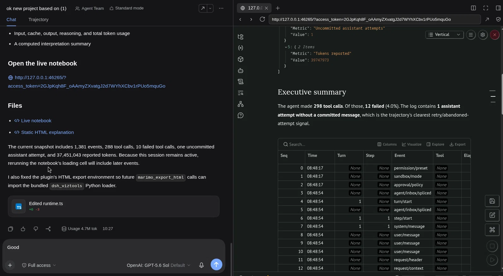

# dsh-viztools

`dsh-viztools` is an MIT-licensed DSH 0.2 plugin that runs one authenticated [marimo](https://marimo.io/) server per workspace, connects its code-mode MCP tools to the agent, and opens the live notebook beside chat.

The first version also includes a read-only Python loader for DSH `session.vN.jsonl[.zstd]` trajectories. A notebook can turn a real run into a timeline, tool-call table, retry view, token chart, and static HTML explanation.

## What it does

- Creates a uv-managed Python environment at `.dsh/marimo/.venv`.
- Pins marimo (`0.25.1` by default) and installs its MCP extras plus `zstandard`.
- Starts marimo on `127.0.0.1` using a free port and a fresh 256-bit token.
- Stops the child process when the Cordis plugin scope is disposed.
- Connects marimo through DSH's official `@deepseek-ai/dsh-mcp-client` bridge.
- Uses marimo's experimental hidden `--mcp=code-mode` mode so the agent can edit the notebook, not just inspect it.
- Sends the authenticated browser URL only through DSH's authenticated Host-to-Client route and opens the right-sidebar Browser automatically; the token never enters a model tool result.
- Registers `marimo_status`, `marimo_export_html`, and the `explain-with-notebook` and `explain-plan` skills.
- Adds `dsh_viztools.session.load_session()` to the notebook's Python path.

## Requirements

- DSH `0.2.0-rc.2` (the MVP pins its DSH peer packages to this exact release candidate).
- Node.js 22 or later.
- [`uv`](https://docs.astral.sh/uv/) 0.11.0 or newer on `PATH` (uv is the only supported Python environment manager).
- Network access on the first start so uv can provision Python and the pinned packages.
- A Web profile with the right-sidebar Browser. The bundled patch enables the shipped Browser entry.

## Install locally

Build the package, then link it into a disposable DSH profile:

```bash
pnpm install
pnpm check

dsh rescue --from-default-profile web --dump-config >/dev/null
dsh plugin --profile rescue link "$PWD"
dsh rescue
```

Use a test profile first. The plugin does not modify your active Web profile unless you explicitly install it there.

For a published package:

```bash
dsh plugin --profile rescue add dsh-viztools
dsh rescue
```

On first boot, environment setup can take a minute. Once a Session is mounted, the live notebook opens automatically in the right-sidebar Browser. `marimo_status` reports readiness and the notebook path without exposing the authentication token.

## Configuration

The bundle adds this entry:

```yaml
- id: dsh-viztools
  name: dsh-viztools
```

Override it in the profile's `cordis.patch.yml`:

```yaml
- id: dsh-viztools
  config:
    notebook: .dsh/notebooks/explanation.py
    environmentDir: .dsh/marimo
    pythonVersion: '3.12'
    marimoVersion: 0.25.1
    mcpCodeMode: true
    autoOpen: true
    exportPath: .dsh/notebooks/explanation.html
    startupTimeoutMs: 180000
```

| Setting | Default | Meaning |
|---|---|---|
| `cwd` | DSH process CWD | Workspace root. An empty value resolves to `process.cwd()` at activation. |
| `notebook` | `.dsh/notebooks/explanation.py` | Managed notebook, constrained to the workspace. |
| `environmentDir` | `.dsh/marimo` | uv environment and version marker, constrained to the workspace. |
| `uvCommand` | `uv` | uv executable name or path. |
| `pythonVersion` | `3.12` | Python version uv provisions. |
| `marimoVersion` | `0.25.1` | Exact marimo version installed. |
| `mcpCodeMode` | `true` | Enable marimo's experimental code-editing MCP tools. |
| `autoOpen` | `true` | Open marimo automatically for each mounted Session through the authenticated Client route. |
| `exportPath` | `.dsh/notebooks/explanation.html` | Default static export destination. |
| `startupTimeoutMs` | `180000` | Setup and readiness timeout. |

The notebook, environment, and export path are rejected if they lexically escape the workspace. The notebook parent is also checked after symlink resolution before marimo starts.

### Offline uv provisioning

The Python environment installs from the hashed [requirements lock](python/requirements.lock). Prepare a transferable uv cache on a connected build machine:

```bash
pnpm run wheelhouse -- dist/offline
```

The script fills `dist/offline/uv-cache`, removes its verification environment, and proves a second clean installation succeeds with `UV_OFFLINE=1` and hash checking enabled. Transfer that cache—and uv itself—to the bench PC or bake both into the Podman image.

```yaml
- id: dsh-viztools-runtime
  config:
    uv:
      command: uv
      minVersion: 0.11.0
      offline: true
      cacheDir: .dsh/offline/uv-cache
      pythonInstallDir: .dsh/offline/python
      requirements: python/requirements.lock
      requireHashes: true
      # Optional alternatives:
      # findLinks: .dsh/offline/wheels
      # indexUrl: https://internal.example/simple
```

For a Podman bundle, copy uv, the verified cache, `python/requirements.lock`, and (when uv manages Python) the populated Python install directory into the image. Configure matching `cacheDir` and `pythonInstallDir`, set `offline: true`, and start once during image validation. A disconnected bench machine then performs no PyPI access.

Changing any uv setting changes the runtime marker and forces deterministic reprovisioning. Startup fails clearly when uv is missing or older than `minVersion`.

### Optional plan-first gate

The enforcement entry is separate from the marimo runtime. **Mount it inside the agent preset's `planning` group that isolates `planMode`**, next to `@deepseek-ai/dsh-plan-mode`. This is how the OTX console is laid out. A gate mounted at profile level cannot see the isolated plan-mode service: it logs a warning and keeps non-planning tools refused, but it cannot switch sessions into plan mode.

```yaml
- insert:
    - id: preset-otx
      name: '@deepseek-ai/dsh-agent-preset'
      config:
        id: otx
        plugins:
          - id: otx-mcp
            name: '@deepseek-ai/dsh-mcp-client'
            config: { transport: stdio, serverName: otx, command: otx-mcp }
          - id: planning
            name: cordis:group
            group: true
            isolate:
              planMode: true
            config:
              - id: plan-mode
                name: '@deepseek-ai/dsh-plan-mode'
                config:
                  section: Inspect with the read-only tools, then submit the plan with exit_plan_mode.
              - id: dsh-viztools-gate
                name: dsh-viztools/gate
                config:
                  planFirst:
                    enabled: true
                    planningTools: [mcp__otx__bench_status, mcp__otx__describe_profile, mcp__otx__get_messages]
                    denialMessage: Plan not approved yet.
```

New sessions, and resumed sessions without an approved plan, enter plan mode. Until a positive `exit_plan_mode` review, only the planning tools and the gate's control tools can execute: `exit_plan_mode`, and `propose_run_rules` when run rules are enabled. Each refusal is written durably at the moment the guard decides it, once per call. Approval survives resume, and forks inherit the gate state at their fork point. If plan mode is not available, the refusal text and the locked viewer both say so, so the session is not silently stuck.

**`run_code` is governed like any other tool.** Its program gets Node APIs (fs, net, child_process) that only the DSH sandbox limits, so allowing it before approval would bypass the gate. It is refused before approval unless the deployment sets `planFirst.allowPtcTransport: true` **and** the session's effective file policy is confined (`read-only` or `workspace-write`, never `danger-full-access` or unknown). The effective policy is the session's latest `sandbox/mode` override, or else the deployment default from DSH's `sandboxPolicy`. Even then it must be in `runRules.allowedTools`, and it is refused while saved rules are invalid. After approval it is governed like any other tool. PTC presets that plan through `run_code` must opt in.

**Delegation** (`subagent`, `subagent_fork`, `workflow`) is refused whenever the gate is active, because a child agent would escape the parent's approval and limits. Set `delegation.allow: true` to opt in. Children created by an allowed delegation call then share the parent's gate: the same approval, rules, and counts. A child that cannot be attached to its parent gets no fresh budget: its limited tools are refused.

Policy is decided per call, not at agent creation. MCP tools that register after the agent exists are handled correctly, and native (non-PTC) presets need no `run_code`. The gate enforces both native calls and nested PTC dispatches. Plan mode alone is not authorization: `/plan off`, a dismissed review, or **Keep planning** does not open the gate.

| `planFirst` | `runRules` | Behavior |
|---|---|---|
| on | off | Planning tools only until approval; then every tool |
| off | on | No plan needed; deployment `allowedTools`/`maxLimits` and approved rules apply |
| on | on | Planning tools (which must be listed in `allowedTools`) until approval; then the deployment ceiling plus approved rules |
| off | off | Gate inactive |

### Approved run rules

The same gate entry can enable typed, user-approved rules that only narrow the deployment's tool policy:

```yaml
runRules:
  enabled: true
  allowedTools: [mcp__otx__bench_status, mcp__otx__get_messages, mcp__otx__replay_tx_only, mcp__otx__diff, mcp__otx__finalize_run]
  maxLimits:
    mcp__otx__replay_tx_only: 6
```

The agent calls `propose_run_rules` with `deny`, `limits`, `notes`, and an optional `allow`. Omitting `allow` keeps the deployment set. An empty `allow` denies every governed tool, and so does an empty intersection of successive approvals. The plugin validates the proposal against the calling agent's tool view, rejects anything outside `allowedTools` or above `maxLimits`, and then asks the user to approve the complete value. Successive approvals only narrow: allowlists intersect, denylists union, and limits take the minimum. A proposal that would leave **no** governed tool allowed — an empty `allow`, an allowlist with nothing in common with earlier approvals, or a deny list covering everything still allowed — is refused before the user is asked, unless the agent passes `confirmDenyAll: true`. When confirmed, the review is headed "DENIES EVERY TOOL" and says the rules cannot be widened later. Every review shows the effective merged rules and the tools still allowed.

Limits count calls that actually started. The guard reserves a slot synchronously, so parallel calls cannot overshoot, and a durable `started` record is written when dispatch begins. Failed calls that started still count. Refused calls, calls aborted before the body ran, and calls to tools that do not exist do not count. Live and resumed counts come from the same fold. Free-text notes enter the system prompt labelled **advisory; not mechanically enforced**.

If saved rules no longer fit the deployment (allowed tools or caps changed), the gate does not fall back to the deployment allowlist. It fails closed: every governed tool is refused with a clear message, a `rules-invalidated` record is written, and a newly approved rule set replaces the stale one.

`explain_plan()` exposes a `rules` table showing enforced rules (including the allowlist), observed calls, refused calls, and advisory notes.

### Where gate and report state is stored

DSH 0.2.0-rc.2 refuses to reopen a session log that contains an unknown event type unless it is marked `ignorable`, and rc.2 gives plugins no way to set that marker. So dsh-viztools **writes no custom event types into `session.jsonl`**. State goes to:

- **DSH 0.2.0-rc.2:** a plugin-owned sidecar per session under the workspace, `<stateDir>/<session>.gate.jsonl` and `<session>.report.jsonl` (default `stateDir: .dsh/viztools/state`). It is append-only, fsync'd after every record, and mode 0600. Each record carries an **HMAC-SHA256 chained to the previous record**. The key lives **outside the workspace** in `<keyDir>/sidecar.key` (default `keyDir: $DSH_HOME/viztools`; a `keyDir` inside the workspace is rejected). A MAC'd **anchor** in `<keyDir>/anchors/` names each session's last record and its fork lineage. Each MAC is bound to the session and channel that wrote it, and verification uses the reader's own session id, so copied records fail. Indices must strictly increase across the whole sidecar, so replaying the session's own older records, including an old reset, breaks the chain. The anchored head must be the last record, or second-to-last when exactly one record follows it (the crash window), and this is checked on every read, also after a reset. Forged appends, edits, copied records, a deleted sidecar, and tail truncation are all detected — by a writer that cannot read the key (see below). An unusable `keyDir` (inside the workspace, wrong owner or permissions, failed creation) makes every session deny all tools with a notice instead of crashing. The key itself is created race-safely: written to a temp file, then hard-linked into place. An empty key file (another process still writing it) is waited for on timers, never with a blocking sleep. On upgrade, a key directory you own that is only group- or world-*readable* (for example 0755) is tightened to 0700 with a notice. A directory that is group- or world-*writable* (0775, 0777, …) is refused with instructions, because its key or anchors may have been replaced. A key *file* readable by others is refused with rotation instructions. Anchor files must be regular files owned by you and not group- or world-writable, otherwise they are not trusted. If the report plugin finds the key still being written, it waits for it (one shared wait of 60 s total, checked every 5 s) and stays enabled. Concurrent triggers for the same report share one waiter. If the key is still not ready, it publishes a "Gave up" state, and the next report tries again. No ancestor of the key directory, up to `/`, may be writable by group or others unless it has the sticky bit (like `/tmp`), and each must be owned by you or root. Otherwise the path to the key could be replaced. Forks inherit their parent's records up to the fork point, recursively through grandchildren.
- **DSH with `appendPluginRecord` (0.2.1+):** ignorable `plugin:dsh-viztools/<channel>` records in the session log, selected automatically at runtime.

The gate fails closed when it cannot trust this state. If the sidecar is missing although its anchor or the session log shows gated activity, or a record fails authentication, or records are missing from the tail, then plan approval is reset and saved rules are refused until they are re-approved. Tools with call limits stay refused for the rest of that session, because their counts can no longer be trusted. The same applies when a completed call to a limited tool in the session log has no recorded decision. A record that authenticates but cannot be interpreted, or state that cannot be read at all, makes the gate **refuse every tool**, with a notice in the refusal and the viewer; it never breaks session creation. The sidecar is located through the gate's `cwd`/`stateDir`, so start the console from the same workspace. Use the same `keyDir` for the gate, the report, and `dsh-viztools-repair`.

> **Tamper evidence has a limit: the agent must not be able to READ the key.** DSH's file sandbox restricts writes, not reads, so under `read-only` or `workspace-write` a tool subprocess can still read `$DSH_HOME/viztools/sidecar.key`. File readers are therefore **deny by default**: every allowed tool counts as one unless it is one of the gate's control tools, `todo_write`, or listed in `keyProtection.safeTools`. Entries are trimmed and are either exact names or one server's MCP tools as `mcp__<server>__*`; no other wildcard is accepted. `""`, `*`, `mcp__*`, generic prefixes such as `b*`, `r*`, or `read*`, a `*` anywhere other than the server-wildcard tail, and server wildcards whose server name contains `__` or starts or ends with `_` are all rejected. Because server names may themselves contain `_` (and `__`), `mcp__otx__*` matches only names that cannot come from a longer server name: tools from servers `otx_` or `otx__evil` are not vouched for. List such tools by exact name. An invalid gate configuration refuses every tool, rather than failing to activate and leaving DSH ungated. This includes unknown keys (typos such as `planfirst`, `enable`, or `runrules` are rejected, with a suggestion), a missing or empty configuration, and a configuration where neither `planFirst.enabled` nor `runRules.enabled` is true. To mount the gate inert on purpose, set `disabled: true` (contradicting it with an enabled feature is also an error). It also includes schema errors such as `planFirst.enabled: "yes"`: the gate hands cordis a permissive schema and validates the real one itself inside `apply`. As a result, `dsh --dump-config-schema` no longer describes the gate's fields; this README is the reference. Allowed tools means `runRules.allowedTools`, or every visible tool when run rules are off. MCP tools, `read_mcp_resource`, `edit`, and the in-process readers (`read`, `read_image`, `grep`, `glob`, `str_replace_editor`) run inside DSH or an MCP server, so nothing can vouch for them except the deployment listing them as safe. Only sandboxed subprocess tools (`bash`, `pwsh`, `run_code`) can be cleared by the probe, where a confined `cat` run through DSH's own sandbox must read a control file in the workspace and fail on the key. While any reader remains, the gate **refuses every tool**. **The OTX console must list its bench tools as safe** (`keyProtection.safeTools: [mcp__otx__*]`), and only if they cannot read arbitrary files.

#### Repairing sessions written by older versions

Sessions written by dsh-viztools up to `ca3b3ca` contain `viztools-*` events that rc.2 refuses to load ("Failed to load history … unknown to this harness and not marked ignorable"). Stop every DSH process that uses the DSH home, then run:

```bash
dsh-viztools-repair --dsh-home ~/.dsh --workspace /path/to/console/cwd --dry-run   # report only
dsh-viztools-repair --dsh-home ~/.dsh --workspace /path/to/console/cwd             # repair
```

Each session is repaired only while holding DSH's own session lease (a non-blocking `flock(2)` on `session.lock`, taken through DSH's native addon or the `flock` command); a session that a running DSH still holds is refused. The repair backs up each changed log under a unique `<log>.viztools-backup-<time>-<random>` name and exports the legacy state into the keyed sidecar (unless one already exists). It then marks the legacy events `ignorable: true` in place, writing through a unique, exclusively created temp file that is fsync'd before the rename. It converts rather than deletes: other events refer to sequence numbers, so deleting events would renumber the log and corrupt it. A fork's inherited legacy events (before its `session/end-seed` cut) are marked but not exported again: they belong to the parent and are inherited through lineage. Zstd logs keep DSH's frame layout, with the header alone in the first frame. Use `--session <id>` to limit the repair to specific sessions, and `--key-dir` if the gate uses a non-default `keyDir`.

### Migration notes (from `ca3b3ca`)

No public config key was renamed or removed. New keys, all optional:

| Entry | Key | Default | Purpose |
|---|---|---|---|
| gate | `planFirst.allowPtcTransport` | `false` | Allow `run_code` before approval (only under a confined file policy) |
| gate | `delegation.allow` | `false` | Allow `subagent`/`subagent_fork`/`workflow`; children share the parent's gate |
| gate | `cwd`, `stateDir` | process cwd, `.dsh/viztools/state` | Where the gate sidecar and status files live |
| gate, report | `keyDir` | `$DSH_HOME/viztools` | HMAC key and anchors; must be outside the workspace (by realpath), owner-only (0700/0600) |
| gate | `keyProtection.safeTools` | `[]` (plus built-in `exit_plan_mode`, `propose_run_rules`, `todo_write`) | Tools vouched not to read files; all others count as readers |
| gate | `keyProtection.fileReadingTools` | `[]` | Tools always treated as readers, even if listed safe |
| report | `stateDir`, `gateStateDir` | `.dsh/viztools/state` | Report sidecar; gate sidecar path passed to templates |
| runtime | `gateStateDir` | `.dsh/viztools/state` | Gate status files shown by the locked viewer |

Behavior changes that can affect existing profiles:

- `run_code` is refused before approval by default. PTC presets that plan through it need `planFirst.allowPtcTransport: true` and a confined file policy.
- Delegation tools are refused whenever the gate is active, unless `delegation.allow: true` is set.
- **`keyProtection` is now deny-by-default (from `804fbef`).** `fileReadingTools` no longer has a default list; it only forces readers. List every allowed tool that cannot read files in `keyProtection.safeTools`, otherwise the gate refuses every tool. The OTX console needs `safeTools: [mcp__otx__*]`.
- **Sessions from `a751b39`** (unkeyed sidecars) open as damaged and fail closed: re-approval is required, and tools with limits stay refused. To recover a session, stop every console and then, for each session:
  1. delete its old sidecars and any anchors: `<workspace>/.dsh/viztools/state/<session>.{gate,report}.jsonl` and `<keyDir>/anchors/<session>.*.json`;
  2. restore the original log from the backup the first repair made (`<log>.viztools-backup-*`, the oldest one) over `session.v4.jsonl[.zstd]`;
  3. run `dsh-viztools-repair` again, which exports the legacy events into a keyed, anchored sidecar.

  Otherwise start new sessions. Sessions from `e27dbcf` keep working: their records still verify.
- Gate and report state moved out of the session log. Run `dsh-viztools-repair` once for sessions written by older versions. Without the repair, those sessions open with fail-closed gate state: plan approval is required again and limited tools stay refused.
- Report templates receive `pluginState` (sidecar paths) in `inputs.json`. Custom templates that read `viztools-*` events from the trajectory should call `dsh_viztools.plugin_state.gate_records(session)` instead, which reads all three backends.

### Automatic reports

Enable the separate report entry to generate a trusted, per-session report without an agent skill or notebook-editing tool:

```yaml
- id: dsh-viztools-report
  name: dsh-viztools/report
  config:
    enabled: true
    triggerTools: [finalize_run, abandon_run]
    triggerOnTurnStop: false
    template: ./templates/otx-report.py  # omit for the bundled template
    templateVersion: otx-v1
    outputDir: .dsh/reports
    environmentDir: .dsh/marimo
    includeCode: false
    extraInputs:
      auditLog: runs/current/audit.jsonl
      manifest: runs/current/manifest.json
```

Before generation the plugin flushes session persistence and asks the JSONL backend for the exact current trajectory path. It writes `.dsh/reports/<session-id>/report.py`, `inputs.json`, and `report.html`; profile-supplied templates receive only structured inputs and trusted workspace paths. `--no-include-code` produces a code-free export by default.

Generation is idempotent on session, trigger sequence, and template version. Both successful and failed attempts become durable records on the plugin `report` channel, so resume does not duplicate an already settled report, and resuming an agent never resets a finished report's state to `pending`. Values extracted from tool results (for example `{runId}`) must match the deployment pattern and must also be a single safe path segment. The bundled template is laid out for the right sidebar. It shows the plan text and approval time, and a **Rules vs. what happened** table: for each tool, the rule (allowed, denied, not in the allowlist), its limit, how many calls started, and how many were refused before and after approval. It also has a narrow tool table without an argument column (arguments are in a collapsed section) and the approved run rules.

When DSH web is present, the report entry serves finished exports at `/api/viztools/report?session=<id>`. That route sits behind DSH's Host/Origin and browser-session authentication and does not depend on marimo. It serves only an `available` export that resolves to that session's `report.html`, with `Cache-Control: no-store` and `Content-Security-Policy: sandbox allow-scripts …`, so report scripts run in an opaque origin and cannot call DSH APIs as the operator.

### Secure automatic sidebar

When a Session appears on screen, the Client plugin requests the marimo URL from `/api/viztools/sidebar-url` and opens it with DSH's existing Browser tab. The route is protected by DSH's Host/Origin and browser-session authentication, sends `Cache-Control: no-store`, and rejects unauthenticated requests. The model-facing `marimo_status` tool returns only the notebook path, loopback port, and marimo version.

### Locked-console mode

Locked mode serves the plugin-owned viewer app bundled in the package. It works from any workspace, including one outside the plugin directory, and is pinned to its real path inside the package:

```yaml
- id: dsh-viztools-runtime
  name: dsh-viztools/runtime
  config:
    mode: managed-readonly
    mcpCodeMode: false
    managedReportRoot: .dsh/reports   # must match the report entry's outputDir
    environmentDir: .dsh/marimo
```

This mode runs `marimo run`, sends no notebook source to the browser, hides detailed tracebacks, exposes no marimo MCP endpoint, and registers no model-facing marimo tools or notebook skills. For the mounted session, the viewer validates the session ID as one safe path segment, polls while the report is pending, embeds the contained export once it is available, and links to the authenticated report route. The export is embedded in a sandboxed iframe at a fixed `80vh` height. `mo.iframe` is not used, because its auto-resize collapsed the frame to about 85 px in the sidebar. Because the export is a marimo app running in an opaque-origin frame, a small script injected as the first element of its `<head>` gives it in-memory `localStorage`/`sessionStorage` (and stubs `indexedDB` when it throws). Without it, Firefox throws `SecurityError` and shows marimo's "Something went wrong — The operation is insecure" after the sidebar tab reloads. The sandbox is not weakened: there is no `allow-same-origin`, and the report is not served from the DSH origin into the frame. Gate notices, such as plan mode being unavailable or damaged state, appear above the report. Set `gateStateDir` to the gate's `stateDir`.


The package exports `checkLockedProfile()` from `dsh-viztools/profile-check`. Internal profile validation should also inspect the complete composition for duplicate editable runtime entries, untrusted template paths, arbitrary code tools, and exact supported version pins. See [THREAT_MODEL.md](THREAT_MODEL.md).

## Explain a DSH session

In a notebook cell:

```python
from dsh_viztools.session import load_session

run = load_session("/path/to/session.v4.jsonl.zstd")
run.summary
```

Useful values:

- `run.header`: physical session header.
- `run.events`: complete decoded event records.
- `run.timeline`: one normalized row per event.
- `run.tool_calls`: calls paired with their results and durations.
- `run.summary`: event, turn, tool failure, retry, and token totals.
- `run.to_polars("timeline")`: optional Polars DataFrame when `polars` is installed in the notebook.

The loader supports plaintext JSONL and concatenated Zstandard frames. It never migrates or writes the source trajectory. It intentionally preserves raw records alongside normalized rows so notebook claims remain traceable.

Ask DSH to load the `explain-with-notebook` skill, point it at a trajectory, and finish by calling `marimo_export_html`.

## Example: explain a real DSH run

The screenshot below is from the first end-to-end test: the agent analyzed the DSH session that built this plugin while the live marimo notebook remained open beside the chat.



The generated report included:

- the complete durable event timeline;
- tool-call counts, failures, and the slowest completed calls;
- assistant attempts without committed messages as retry/abandonment evidence;
- input, cache-read, cache-write, output, reasoning, and total token usage;
- an executive summary computed from the trajectory rather than copied into prose.

Try it with a prompt like:

> Use `explain-with-notebook` to explain this DSH session, including a timeline, tool calls, retries, and token usage. Export the result to HTML.

Or start from the reusable [example notebook](examples/explain-session.py). Set its trajectory field to a local `session.vN.jsonl.zstd` file, then run its cells. A captured [static HTML example](examples/session-explanation.html) is also included so the result can be reviewed without starting DSH or marimo.

The counts in the screenshot are a point-in-time snapshot of an active session. Rerunning the notebook's loading cell reads the current trajectory and recomputes every table and summary.

## Explain a plan—or a Standard-mode execution

`explain-plan` prefers the exact Markdown submitted through `exit_plan_mode`, but it no longer fails when a Standard-mode session has no durable plan. It always returns the native/MCP execution inventory; comparison fields become unavailable until a user-provided or explicitly reconstructed plan is supplied. It understands ordinary `tool/call` events and nested PTC dispatches, and splits names such as `mcp__context7__search` into server `context7` and operation `search`.

```python
from dsh_viztools.session import load_session

run = load_session("/path/to/session.v4.jsonl.zstd")
plan = run.explain_plan()       # submitted plan, or execution-only evidence
# plan = run.explain_plan(0)    # select an earlier durable submission

# Fallback for a Standard-mode session:
provided = run.explain_plan(
    plan_markdown="# Project plan\n\n## Inspect\nRead the current implementation.",
    source="user-provided",     # or "reconstructed"
    boundary_seq=42,             # omit to use session start
)

plan.plan              # source, approval status, boundary, and optional Markdown
plan.phases            # headings and attribution keywords
plan.calls             # post-submission native and PTC calls
plan.tool_inventory    # counts and failures by tool
plan.mcp_inventory     # counts by MCP server and operation
plan.summary           # computed plan/execution totals
```

A useful prompt is:

> Use `explain-plan` to compare the approved plan with this session's execution. Show native and MCP tools, failures, retries, phase attribution, unmapped work, and supporting evidence. Export it to HTML.

A reusable [plan-explanation notebook](examples/explain-plan.py) is included. Its controls let you choose a submitted plan, paste a user-provided plan, or paste a reconstructed plan and optionally set the exact execution-boundary sequence.

Plan-source labels are explicit:

- **Submitted DSH plan** — durable `exit_plan_mode` evidence;
- **User-provided plan; approval not observed** — supplied text, not a recorded approval;
- **Reconstructed plan; not an approved plan** — an interpretive fallback;
- **No plan observed — execution evidence only** — tools, failures, retries, and timing remain reportable without comparison.

Evidence labels are intentionally conservative:

- **direct** means the trajectory records the call, result, order, or timing;
- **heuristic** means a call was associated with a plan phase by keyword overlap;
- **not observed** means there is not enough durable evidence for that attribution.

An unmapped call may be unplanned work or simply lack matching prose. Likewise, a phase with no mapped call is not automatically skipped: discussion and analysis can happen without a tool call.

## Security model

A marimo code-mode notebook executes arbitrary Python with the same operating-system authority as the DSH process. Treat it as shell-equivalent.

This MVP reduces accidental exposure but is **not a sandbox**:

- marimo binds only to `127.0.0.1`;
- every activation gets a random token;
- the tokenized URL is returned only by an authenticated, no-store Host route to the Client plugin and is never included in `marimo_status`;
- DSH's Browser layout may retain that URL locally, but its random token becomes useless when this plugin process stops;
- managed paths stay in the workspace;
- model tool calls still traverse DSH's normal tool policy and approval pipeline;
- the browser iframe uses DSH's existing sandbox, including `allow-same-origin` and WebSocket support;
- the embedded report frame and the authenticated report route both run the export in an opaque origin (`sandbox` without `allow-same-origin`);
- gate sidecars and status files are mode 0600 and contain tool names, call ids, decision codes, and reasons only, never arguments or tokens.

Do not install editable mode in a locked production/OTX console. A later read-only profile should run existing notebooks without code-mode MCP and expose only read operations.

## Current limitations

- marimo's code-mode MCP flag is experimental and hidden in marimo 0.25.1; an upstream change may require a plugin update.
- Environment installation happens during plugin activation and requires network access on the first run.
- This MVP manages one notebook/server per plugin instance (normally one per workspace process).
- The trajectory loader normalizes core message/tool/token fields defensively; plugin-defined events remain available in `run.events` but may not receive specialized columns.
- Plan-phase attribution is intentionally heuristic. DSH durably records the submitted plan and tool activity, but it does not record an authoritative plan-step identifier on each later call.
- Sidebar viewing depends on DSH's Browser plugin and therefore on iframe/WebSocket compatibility in the installed DSH build.
- `polars` is not installed by default; use Python lists, marimo tables, or install it in the notebook environment.

## Roadmap

See [ROADMAP.md](ROADMAP.md) for the implementation history and remaining release gate. Version support and exact DSH peer-pin policy are documented in [COMPATIBILITY.md](COMPATIBILITY.md). Completed milestone results are recorded in [CHANGELOG.md](CHANGELOG.md). Security boundaries are in [THREAT_MODEL.md](THREAT_MODEL.md), and [SECURITY_REVIEW.md](SECURITY_REVIEW.md) lists automated evidence plus the internal checks required before v1 publication.

## Development

```bash
pnpm typecheck
pnpm test
pnpm build
pnpm pack --dry-run
pnpm test:integration   # real DSH web console, see below
```

`pnpm test:integration` boots real DSH 0.2.0-rc.2 web in the OTX console topology: a scripted mock LLM, a stdio MCP fixture that registers its tools late, plan mode plus the gate in the preset's isolated `planning` group, the locked runtime started from a workspace outside the plugin directory, and a test-only answerer that approves reviews. A headless Chromium drives it at 1910×916. The test checks the sidecar, the bench call log, the report route and viewer, and the report iframe height. It then injects a legacy event, runs `dsh-viztools-repair`, restarts DSH, reopens the original session, and checks that the resumed counts equal the live counts. It needs `dsh` and `zstd` on PATH, and `playwright-core` plus a Chromium binary (`PLAYWRIGHT_CORE_DIR`, `CHROMIUM_PATH`).

Python loader tests run with the system Python and do not require marimo. The live smoke test provisions the uv environment and should be run explicitly against a disposable DSH profile.

## License

MIT. marimo is Apache-2.0 and is installed as a runtime dependency in the workspace-local Python environment; its source is not vendored here.
